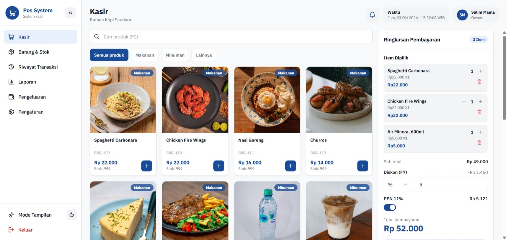

# POS Cashier App

A point-of-sale (POS) web app for cafes and restaurants, built with Next.js. It covers the cashier screen, inventory, transaction history, financial reports, expenses, and store settings.

**Live demo:** (https://xyz-pos.vercel.app/)



> The interface is in **Indonesian** (Bahasa Indonesia). Currency is formatted as Rupiah (`Rp 12.000`) and dates as `22/12/2025 12:00`.

## Try it

Sign in with one of the sample accounts (also shown on the login page):

| Role    | Username | Password   | Access                                              |
| ------- | -------- | ---------- | --------------------------------------------------- |
| Owner   | `owner`  | `owner123` | Everything                                          |
| Cashier | `kasir`  | `kasir123` | Cashier, Inventory (view only), Transaction History |

Sample data (a cafe menu, two weeks of transactions, and a few expenses) is generated on first load. The **Reset** link at the top of the app restores it at any time.

## Features

**Cashier**

- Product catalog with search, category tabs, and product photos
- Cart with stock limits, discounts (percent or fixed amount, capped by a configurable maximum), VAT, and Cash / QRIS / Debit payment
- Daily order numbers that restart at 001 each day, matching the last digits of the transaction number
- Receipt printing for thermal printers (58, 80, or 88 mm paper)
- Keyboard shortcuts: `F2` search, `F7` discount, `F9` pay

**Inventory**

- Add, edit, and delete products, active/inactive status, low-stock warning
- Product photo upload, automatically cropped to a square and resized to 400 x 400 px
- Pagination, filters, search, and PDF export through the print dialog

**Transaction history**

- Summary of transaction count, sales, and gross profit
- Date range filter, search, transaction details, and receipt reprint

**Reports** (Owner only)

- Daily revenue, daily expenses, and revenue-versus-expenses charts
- Payment method breakdown
- Printable report

**Expenses** (Owner only)

- Expense tracking by category with attachments, date filter, and printing

**Settings** (Owner only)

- Store profile and logo, VAT, rounding, maximum discount, transaction number format, and printer options
- User management: add, deactivate, reset password, and delete users
- Data export to JSON

**General**

- Light and dark mode, collapsible sidebar
- Owner and Cashier roles with menu restrictions
- Smooth animations that respect `prefers-reduced-motion`

## Tech stack

- [Next.js](https://nextjs.org) (App Router), React, and TypeScript
- [Tailwind CSS](https://tailwindcss.com) v4
- [Zustand](https://zustand-demo.pmnd.rs) for state
- [Recharts](https://recharts.org) for charts
- [Framer Motion](https://www.framer.com/motion/) for animation
- [Lucide](https://lucide.dev) icons and [next-themes](https://github.com/pacocoursey/next-themes) for dark mode
- IBM Plex Sans font

## Getting started

Requires Node.js 20 or newer.

```bash
git clone https://github.com/Slmmaula/pos-cashier-app.git
cd pos-cashier-app
npm install
npm run dev
```

Open [http://localhost:3000](http://localhost:3000). No environment variables or external services are needed.

Other scripts:

```bash
npm run build   # production build
npm run start   # run the production build
npm run lint    # lint the code
```

## How it works

- There is **no backend and no database**. All data (products, transactions, expenses, settings, and users) lives in the browser's `localStorage`. Each visitor has their own separate data, and it is lost if site data is cleared.
- Sample dates are calculated relative to today, so reports and history always look current.
- Transaction logic (stock validation, discount, VAT, rounding, and daily order numbers) runs in the browser in `src/lib/db/`.
- Product photos shown on the cashier screen come from `public/products/<product-code>.jpg` unless a photo was uploaded in the app.

## Limitations

- Authentication is a UI guard only. Passwords are stored as plain text in the browser, so this app is **not suitable for real business data as it is**.
- Data does not sync between browsers or devices.
- Uploaded photos and attachments are stored in the browser, so their size is limited.

## Project structure

```
src/
  app/            routes (App Router)
  components/     UI and layout components
  features/       per-menu components (cashier, inventory, history, reports, ...)
  lib/            formatting, calculations, and the data layer (lib/db, lib/demo)
  store/          app state (zustand)
public/products/  sample product photos (BRG-101.jpg, ...)
docs/screenshots/ README screenshot
```

## Contributing and extending

The data layer is isolated in `src/lib/db/` (plus `src/store/auth-store.ts` for sign-in), and the screens only call those functions. To connect a real backend, reimplement those modules against your database and keep the function signatures. Ideas for contributions:

- A real backend with proper authentication and per-role access rules
- Per-page loading for transaction history
- Ingredient-level stock tracking
- English translation of the interface

Issues and pull requests are welcome.
